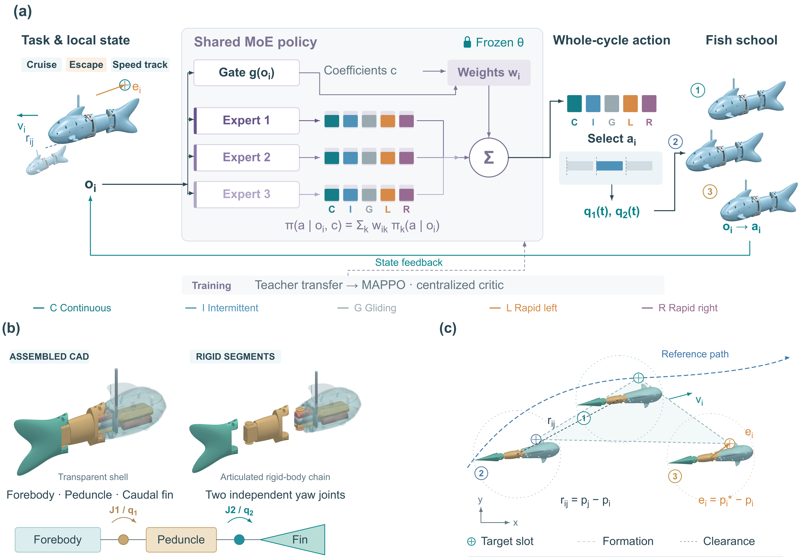

# MAMoE-Fish

### From swimming primitives to collective behaviors

**Shared feedback experts · Task-specific gating · Articulated robotic fish**

[Project website](https://Sunweiyuan01.github.io/MAMoE-Fish/) · [Quick start](#quick-start) · [Method](guide/METHOD.md) · [Training](guide/TRAINING.md)



MAMoE-Fish combines a bank of feedback policies with task-specific gates. Each expert produces a probability distribution over five complete swimming primitives. A gate mixes those distributions using the current observation, and the selected primitive drives the two joints for one complete cycle. The repository provides the control core, articulated MuJoCo models, representative actor checkpoints, training entry points. Evaluation and CFD datasets are being organized and are not included in this release.

## How it works

1. **Observe:** each fish receives a 35-component local observation, including tracking state, neighbors and task commands.
2. **Compose:** shared experts use a 25-component feedback subset; a task-specific gate uses the full observation.
3. **Execute:** select continuous swimming, intermittent swimming, gliding, left turning or right turning; execute its 0.5 s joint-reference trajectory.
4. **Adapt:** retain the expert bank and optimize a target gate with a separately trained centralized critic.

Training branches for escape and speed originate independently from the source task. Executing a sequence of trained policies is a separate deployment operation. This compact release exposes task-level rollouts; it does not provide the larger-group mission coordinator.

## Quick start

Python **3.12**. Run from the repository root. Use a virtual environment:

```bash
git clone https://github.com/Sunweiyuan01/MAMoE-Fish.git
cd MAMoE-Fish
python -m venv .venv
```

Activate with `.venv\Scripts\Activate.ps1` in PowerShell, or `source .venv/bin/activate` on Linux/macOS.

```bash
python -m pip install -r requirements.txt
python tools/verify_release.py
python tests/smoke.py
python tools/run_demo.py --task cruise --steps 4 --output outputs/cruise.npz
python tools/plot_demo.py outputs/cruise.npz
```

The demo uses a released actor and saves time, planar states, discrete actions, gate weights and action probabilities. Four decisions cover 2 s; this is a bounded execution example. Use `--task escape` or `--task speed` to select another actor and its matching environment. Use `--steps 180` for a full escape episode or `--steps 120` for cruise/speed, subject to termination conditions.

## Repository map

| Directory | Contents |
|---|---|
| `code/` | Actor, critic, primitives, environment, initialization and PPO training |
| `model/` | Three-fish and isolated-fish XML, visual meshes |
| `checkpoints/` | Three representative seed-8101 actor-only checkpoints |
| `tools/` | Rollout, plotting and checksum utilities |
| `guide/` | Method, training, data/version details and verification |
| `docs/` | Static GitHub Pages website |

## Core interfaces

`Actor.parts(observations)` returns mixed action probabilities, gate weights and expert distributions. `Environment.step(actions)` consumes three action IDs and advances one full primitive. `physics.primitive(action, t)` returns two joint references in radians.

The historical `FAMoEController` class name is retained for compatibility. It expects a separately assembled `famoe_frozen_bank_three_gates_v1` bundle. Released actor-only checkpoints instead use `tools/run_demo.py`; they are not interchangeable formats.

## Data and configuration

The model uses 0.0005 s physics integration and 0.5 s decisions. The base environment retains the original 3 mm/s pursuit setting; the provided escape actor uses the separate 25 mm/s environment selected automatically by the demo. See [versions and scope](guide/VERSIONS.md).

The training commands and configuration are described in [TRAINING.md](guide/TRAINING.md). [VERIFICATION.md](guide/VERIFICATION.md) records checks actually performed for this release. Evaluation datasets and the source teacher archive are withheld pending organization. Local machine paths and unnecessary checkpoint metadata are excluded from the publication package.

## Citation and rights

For software attribution, cite the repository URL and the commit used. A formal paper citation can be added after its bibliographic record is available.

This repository is publicly viewable. **No open-source or open-data license has been granted.** See [RIGHTS.md](RIGHTS.md) and [third-party notices](THIRD_PARTY.md).
